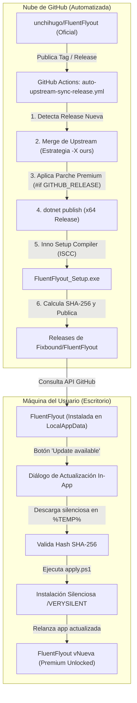

# Auditoría Técnica: Pipeline de Actualización y Auto-Sincronización de FluentFlyout

**Repositorio:** [Fixbound/FluentFlyout](https://github.com/Fixbound/FluentFlyout)  
**Upstream Oficial:** [unchihugo/FluentFlyout](https://github.com/unchihugo/FluentFlyout)  
**Fecha de Generación:** 10 de Noviembre de 2026  
**Objetivo:** Describir la arquitectura del actualizador in-app, los componentes modificados y el funcionamiento del workflow desatendido en GitHub Actions.

---

## 1. Arquitectura General del Ciclo

El sistema está diseñado en dos niveles complementarios:



---

## 2. Componentes Modificados en el Código Fuente

### 2.1. [`UpdateCheckerService.cs`](file:///E:/Programacion/FluentFlyout/FluentFlyoutWPF/Classes/Services/UpdateCheckerService.cs)
- **Repositorio por defecto:** Se reconfiguró `DefaultGitHubOwner = "Fixbound"` para que la aplicación consulte exclusivamente las releases de tu cuenta.
- **Detección de Assets Ejecutables:** El parser de assets ahora reconoce instaladores `.exe` (`FluentFlyout_Setup.exe`) además de los `.zip` originales, priorizando arquitecturas x64.
- **Extracción Robusta de SHA-256:** Se implementó una cascada de expresiones regulares (`Sha256WorkflowRegex`, `Sha256X64Regex`, `Sha256FallbackRegex`, `Sha256GenericRegex`) que extrae el hash de las notas de la release sin importar la variante de formato en Markdown o tablas.
- **Aislamiento de Upstream:** Cuando la compilación se realiza bajo la constante `GITHUB_RELEASE`, se desactiva por completo la llamada al backend alternativo del autor original, garantizando soberanía de red.

### 2.2. [`UpdateInstallerService.cs`](file:///E:/Programacion/FluentFlyout/FluentFlyoutWPF/Classes/Services/UpdateInstallerService.cs)
- **Descarga Nativa Asíncrona:** Se reemplazó cualquier dependencia de herramientas CLI externas por `HttpClient` administrado en streaming continuo directamente a disco.
- **Validación Criptográfica:** Uso de `System.Security.Cryptography.SHA256.HashDataAsync` para validar el hash antes de cualquier ejecución o extracción.
- **Instalador Inno Setup (`.exe`):** Se adaptó el pipeline para ejecutar directamente instaladores `.exe` con los argumentos `/VERYSILENT /SUPPRESSMSGBOXES /NORESTART`.
- **Script Desacoplado `apply.ps1`:**
  - Espera a que el proceso actual de `FluentFlyout` termine (`Wait-Process`).
  - Fuerza la terminación de instancias remanentes para evitar bloqueos de archivos en disco.
  - Ejecuta el instalador silencioso en el contexto de usuario actual.
  - Inicia la aplicación recién instalada fijando explícitamente su `-WorkingDirectory` en `%LocalAppData%\Programs\FluentFlyout`, evitando bloqueos de carpetas temporales.
- **Gestión de Carpetas Temporales (`CleanOldUpdateRuns`):** Mantiene únicamente las últimas 3 carpetas de ejecución en `%TEMP%\FluentFlyout\updates\`, eliminando automáticamente versiones antiguas.

### 2.3. [`HomePage.xaml.cs`](file:///E:/Programacion/FluentFlyout/FluentFlyoutWPF/Pages/HomePage.xaml.cs)
- **Enrutamiento de Botones:** Tanto el botón grande de tarjeta **"View Updates"** como la píldora **"Update available"** invocan directamente `UpdateInstallerService.ShowUpdateChoiceAndApplyAsync()` en lugar de abrir el navegador web cuando hay una actualización disponible.

### 2.4. [`FluentFlyout_Setup.iss`](file:///E:/Programacion/FluentFlyout/FluentFlyout_Setup.iss)
- **Instalador de Usuario (Sin UAC innecesario):** Configurado con `PrivilegesRequired=lowest` para instalar en `{localappdata}\Programs\FluentFlyout`. No requiere permisos de administrador del sistema.
- **Rutas Relativas:** Configurado para compilar idénticamente en tu entorno local (`publish_x64`, `InstallerOutput`) y en los runners de GitHub Actions (`windows-latest`).

### 2.5. Parche de Funciones Premium
- Desbloqueado mediante la directiva de compilador `#if GITHUB_RELEASE` en `LicenseManager.cs`, liberando funciones como Taskbar Widget, Taskbar Visualizer, animaciones y opciones avanzadas.

---

## 3. Workflow de GitHub Actions

**Archivo:** [`.github/workflows/auto-upstream-sync-release.yml`](file:///E:/Programacion/FluentFlyout/.github/workflows/auto-upstream-sync-release.yml)

### 3.1. Disparadores
```yaml
on:
  schedule:
    - cron: '0 */6 * * *'    # Cada 6 horas
  workflow_dispatch:          # Ejecución manual desde la web de GitHub
    inputs:
      force_build:
        description: 'Forzar compilación aunque la versión coincida'
        required: false
        type: boolean
        default: false
```

### 3.2. Paso a Paso del Job (`check-and-release`)

1. **Comparación de Versiones (`check_release`):**
   - Consulta vía GitHub API la última release en `unchihugo/FluentFlyout`.
   - Consulta la última release en `Fixbound/FluentFlyout`.
   - Si upstream tiene una etiqueta más reciente (o si se activa `force_build`), define `SHOULD_BUILD=true`. En caso contrario, termina de forma limpia sin consumir tiempo de cómputo.

2. **Merge de Cambios Oficiales:**
   - Hace checkout de tu rama `master`.
   - Agrega `upstream` y ejecuta `git merge $target -m "..." --allow-unrelated-histories -X ours`.
   - La estrategia `-X ours` asegura que cualquier conflicto en archivos propios (como `UpdateCheckerService.cs`, `HomePage.xaml.cs` o el script `.iss`) mantenga siempre tus parches locales intactos sobre el código upstream.

3. **Instalación de Dependencias:**
   - Prepara el SDK oficial de **.NET 10.0.x** mediante `actions/setup-dotnet@v5`.
   - Instala **Inno Setup 6** en el runner mediante Chocolatey (`choco install innosetup --no-progress`).

4. **Sincronización de Versión:**
   - Actualiza automáticamente las etiquetas `<Version>`, `<AssemblyVersion>` y `<FileVersion>` en `FluentFlyout.csproj`.
   - Actualiza `#define MyAppVersion` en `FluentFlyout_Setup.iss`.

5. **Compilación y Empaquetado:**
   - Ejecuta `dotnet publish FluentFlyoutWPF/FluentFlyout.csproj -c Release -r win-x64 --no-self-contained -o publish_x64 /p:DefineConstants="GITHUB_RELEASE"`.
   - Compila el instalador final con `ISCC.exe FluentFlyout_Setup.iss`, generando `InstallerOutput/FluentFlyout_Setup.exe`.

6. **Publicación Criptográfica en Releases:**
   - Calcula el hash SHA-256 del ejecutable.
   - Crea o actualiza la release en `Fixbound/FluentFlyout` adjuntando el instalador y la tabla Markdown con el checksum verificado:
     ```markdown
     | Version | SHA-256 hash |
     |---|---|
     |GitHub Release x64|<sha256>|
     ```

7. **Actualización de Rama Master:**
   - Realiza commit de las versiones actualizadas y hace `git push origin master`.

---

## 4. Cómo Auditar o Probar Manualmente

### Prueba Manual del Workflow en GitHub
1. Ingresa a tu repositorio en GitHub: [Fixbound/FluentFlyout/actions](https://github.com/Fixbound/FluentFlyout/actions).
2. Selecciona en el menú izquierdo **"Auto Upstream Sync & Release"**.
3. Haz clic en el botón desplegable **"Run workflow"**.
4. Puedes marcar `force_build = true` para probar la compilación y publicación completa de inmediato.

### Verificación del Hash Local
Si descargas cualquier `FluentFlyout_Setup.exe`, puedes verificar su integridad en PowerShell con:
```powershell
(Get-FileHash .\FluentFlyout_Setup.exe -Algorithm SHA256).Hash
```
El valor resultante coincidirá de forma idéntica con el publicado en la tabla de tu release.

---

## 5. Mejoras de Auditoría y Hardening Aplicadas

1. **`auto-upstream-sync-release.yml` (Hardening Completo):**
   - Removido el switch erróneo `-ErrorAction` sobre comandos nativos `git`.
   - Reemplazado `--clobber` en `gh release create` por lógica dual: crea con `--target master` si no existe, o edita y sube con `gh release upload --clobber` si ya existe (para re-ejecuciones forzadas).
   - Invertido el orden del pipeline: primero realiza `commit` y `push` de las versiones actualizadas a `origin master`, y luego publica la release apuntando formalmente al `master` ya sincronizado.
   - Manejo de conflictos de merge con verificación de `$LASTEXITCODE` y resolución de árbol con `-X ours`.

2. **`build-msix.yml` (Heredado de la tienda Microsoft):**
   - Desactivado su disparador automático en `push` a ramas estándar para evitar fallos por falta de certificados de tienda en forks. Solo se mantiene activo para tags manuales o `workflow_dispatch`.

3. **`notify-website.yml`:**
   - Agregada la condición `if: github.repository == 'unchihugo/FluentFlyout'` para evitar fallos por falta del secreto `PAGES_CONTROLLER_PAT` en tu fork.

4. **`UpdateInstallerService.cs` y Seguridad In-App:**
   - Elevación selectiva: `Verb = isExe ? string.Empty : "runas"`, garantizando que el instalador de usuario Inno Setup (`FluentFlyout_Setup.exe`) corra directamente en el contexto del usuario actual sin UAC y sin riesgo de instalar en el perfil del Administrador.
   - Verificación estricta de hash SHA-256: bajo `#if GITHUB_RELEASE`, se bloquea la instalación si el hash esperado está ausente.

5. **`HomePage.xaml.cs` (Feedback de Usuario):**
   - Agregado bloqueo reentrante (`_isApplyingUpdate`) y estado visual `"Downloading update..."` para prevenir descargas duplicadas concurrentes mientras el usuario espera.

6. **`MainWindow.xaml.cs` (Inicio Automático en Registro):**
   - Corregido el registro en `Run` para fijar siempre `"executablePath" --autostart`, preservando el inicio minimizado en la bandeja del sistema.
